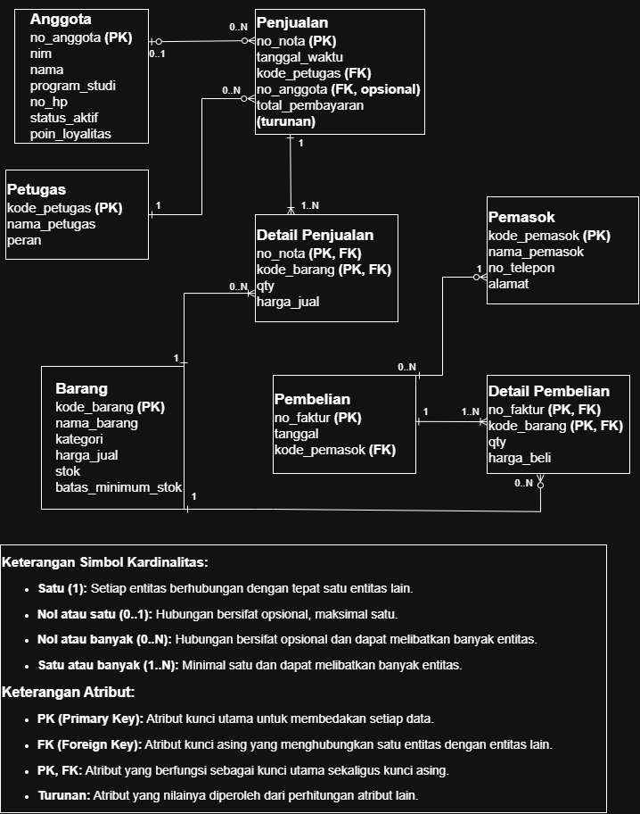
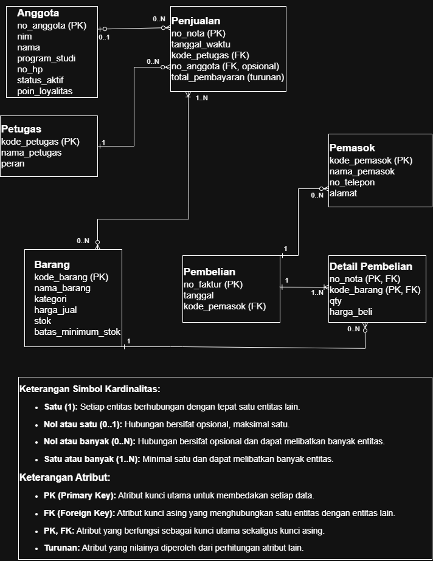
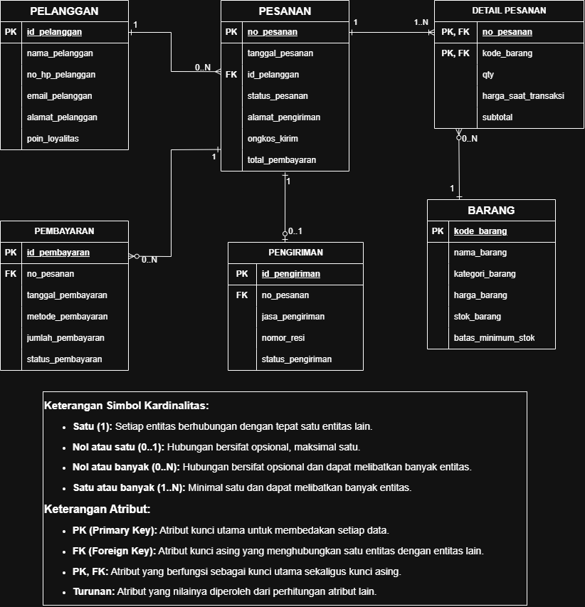
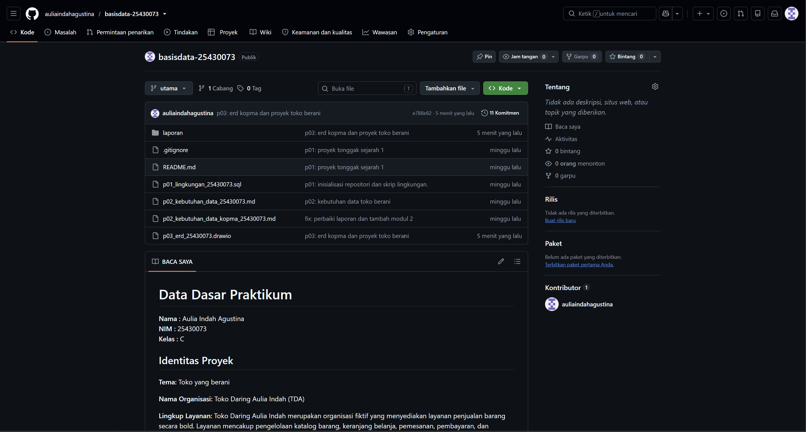
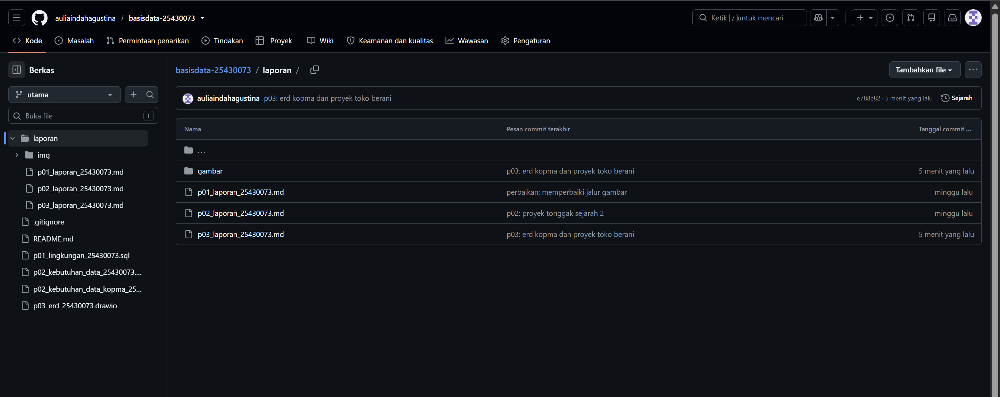

# Laporan Praktikum Basis Data - Pertemuan ke 3
**Nama:** Aulia Indah Agustina
**NIM:**25430073
**Kelas:** C
**Tanggal:** 12/10/2025
**Dosen:** Dedi Irawan, S.Kom., M.T.I.

## 1. Tujuan Praktikum
- Praktikum ini bertujuan untuk mempelajari cara mengenali entitas, atribut, dan kunci berdasarkan dokumen kebutuhan data. Selain itu, praktikum ini mengasah keterampilan dalam menetapkan hubungan, kardinalitas, dan partisipasi antarentitas berdasarkan aturan bisnis. Mahasiswa diharapkan dapat memodelkan hubungan yang kompleks dengan banyak entitas melalui entitas asosiatif, merancang ERD menggunakan notasi Crow’s Foot, serta memverifikasi kesesuaiannya dengan kebutuhan informasi.

## 2. Ringkasan Dasar Teori
- Model Entity-Relationship (ER) digunakan untuk merepresentasikan data melalui entitas, atribut, serta hubungan. ERD adalah desain konseptual yang menjamin kebutuhan data telah terakomodasi sebelum memilih jenis data atau DBMS yang akan digunakan. Dalam ERD, kardinalitas menunjukkan jumlah maksimal relasi antara entitas, sementara partisipasi menjelaskan apakah relasi itu wajib atau bersifat opsional. Keduanya harus ditentukan berdasarkan aturan bisnis. Relasi banyak-ke-banyak yang memiliki atribut spesifik, seperti jumlah item dan harga selama transaksi, perlu diuraikan dengan entitas asosiatif, misalnya `detail_penjualan`, yang menghubungkan entitas Penjualan dan Barang.

## 3. Hasil Langkah Percobaan (tangkapan layar + keterangan)

## D.1 Identifikasi Primary Key, Foreign Key, dan Atribut Turunan

### 1. Identifikasi Entitas Anggota
Berdasarkan dokumen kebutuhan data Kopma, entitas Anggota memiliki atribut nomor anggota, NIM, nama, program studi, nomor HP, status aktif, dan poin loyalitas.

**a. Primary Key (PK)**
`no_anggota` dipilih sebagai primary key karena setiap anggota memiliki nomor anggota yang unik.

**b. Kunci Alternatif**
`nim_anggota` menjadi kunci alternatif karena NIM anggota juga harus unik. Dengan demikian, NIM dapat digunakan untuk mencari atau mengenali anggota selain melalui nomor anggota.

**c. Atribut Turunan**
`poin_loyalitas` perlu ditinjau sebagai atribut yang nilainya dapat dihitung berdasarkan transaksi belanja anggota. Berdasarkan aturan bisnis AB-07, setiap kelipatan Rp10.000 yang dibelanjakan anggota menghasilkan 1 poin loyalitas. Selain itu, aturan bisnis AB-08 menyatakan bahwa setiap penukaran 50 poin memberikan potongan sebesar Rp5.000. Oleh karena itu, perhitungan poin perlu memperhatikan poin yang diperoleh dan poin yang telah ditukarkan.

### 2. Identifikasi Entitas Barang
Berdasarkan dokumen kebutuhan data Kopma, entitas Barang memiliki atribut kode barang, nama barang, kategori, harga jual, stok, dan batas minimum stok.

**a. Primary Key (PK)**
`kode_barang` ditetapkan sebagai primary key karena digunakan sebagai identitas barang dalam sistem.

**b. Kunci Alternatif**
Belum terdapat kunci alternatif yang ditetapkan pada entitas Barang dalam dokumen kebutuhan data Kopma.

**c. Atribut Turunan**
Berdasarkan dokumen kebutuhan data, belum terdapat atribut yang secara eksplisit ditetapkan sebagai atribut turunan pada entitas Barang.

### 3. Identifikasi Entitas Penjualan
Berdasarkan dokumen kebutuhan data Kopma, entitas Penjualan memiliki atribut nomor nota, tanggal-jam, kasir, anggota (opsional), dan bayar.

**a. Primary Key (PK)**
`no_nota_penjualan` ditetapkan sebagai primary key karena setiap nota memiliki nomor unik, sesuai dengan aturan bisnis AB-01.

**b. Kunci Alternatif**
Belum terdapat kunci alternatif yang ditetapkan pada entitas Penjualan dalam dokumen kebutuhan data Kopma.

**c. Atribut Turunan**
Atribut `bayar` perlu ditinjau lebih lanjut karena dokumen kebutuhan data belum menjelaskan secara terperinci cara memperoleh nilainya dari atribut lain. Oleh karena itu, atribut ini belum dapat dipastikan sebagai atribut turunan hanya berdasarkan informasi yang tersedia.

### 4. Identifikasi Entitas Detail Penjualan
Berdasarkan dokumen kebutuhan data Kopma, entitas Detail Penjualan memiliki atribut nomor nota, barang, qty, dan harga saat transaksi.

**a. Primary Key (PK)**
Primary key pada Detail Penjualan menggunakan gabungan `no_nota_penjualan` dan `kode_barang`. Gabungan ini digunakan untuk membedakan barang yang tercatat pada setiap nota penjualan.

**b. Kunci Alternatif**
Belum terdapat kunci alternatif yang ditetapkan pada entitas Detail Penjualan dalam dokumen kebutuhan data Kopma.

**c. Atribut Turunan**
Dokumen kebutuhan data Kopma belum mencantumkan atribut turunan secara eksplisit pada Detail Penjualan. Namun, berdasarkan konsep atribut turunan dalam buku praktikum, nilai subtotal dapat dihitung dari qty × harga_saat_transaksi. Harga saat transaksi tetap disimpan agar nilai transaksi tidak berubah ketika harga barang diperbarui.

### 5. Identifikasi Entitas Petugas
Berdasarkan dokumen kebutuhan data Kopma, entitas Petugas memiliki atribut kode petugas, nama, dan peran.

**a. Primary Key (PK)**
`kode_petugas` ditetapkan sebagai primary key karena digunakan sebagai identitas petugas dalam sistem.

**b. Kunci Alternatif**
Belum terdapat kunci alternatif yang ditetapkan pada entitas Petugas dalam dokumen kebutuhan data Kopma.

**c. Atribut Turunan**
Belum terdapat atribut yang ditetapkan sebagai atribut turunan pada entitas Petugas berdasarkan dokumen kebutuhan data Kopma.

### 6. Identifikasi Entitas Pemasok
Berdasarkan dokumen kebutuhan data Kopma, entitas Pemasok memiliki atribut kode pemasok, nama, telepon, dan alamat.

**a. Primary Key (PK)**
`kode_pemasok` ditetapkan sebagai primary key karena digunakan sebagai identitas pemasok dalam sistem.

**b. Kunci Alternatif**
Belum terdapat kunci alternatif yang ditetapkan pada entitas Pemasok dalam dokumen kebutuhan data Kopma.

**c. Atribut Turunan**
Belum terdapat atribut yang ditetapkan sebagai atribut turunan pada entitas Pemasok berdasarkan dokumen kebutuhan data Kopma.

### 7. Identifikasi Entitas Pembelian
Berdasarkan dokumen kebutuhan data Kopma, entitas kandidat Pembelian memiliki atribut nomor faktur, tanggal, pemasok, barang, qty, dan harga beli.

**a. Entitas Pembelian**
- **Primary Key (PK):** `no_faktur`, karena nomor faktur digunakan untuk mengidentifikasi transaksi pembelian.
- **Kunci Alternatif:** Belum ditetapkan dalam dokumen kebutuhan data Kopma.
- **Atribut Turunan:** Belum ada atribut yang ditetapkan sebagai atribut turunan pada entitas Pembelian.

Atribut entitas Pembelian meliputi `no_faktur`, `tanggal`, dan `kode_pemasok`.

**b. Entitas Detail Pembelian**
- **Primary Key (PK):** Gabungan `no_faktur` dan `kode_barang`, dengan asumsi satu barang hanya dicatat satu kali dalam satu faktur.
- **Kunci Alternatif:** Belum ditetapkan dalam dokumen kebutuhan data Kopma.
-**Atribut Turunan:** Dokumen kebutuhan data Kopma belum mencantumkan atribut turunan secara eksplisit pada Detail Pembelian. Namun, berdasarkan konsep atribut turunan dalam buku praktikum, nilai subtotal pembelian dapat dihitung dari qty × harga_beli. Nilai subtotal tersebut merupakan hasil perhitungan, bukan atribut baru yang telah ditetapkan dalam dokumen kebutuhan data.

Gambar 1. ERD utama Kopma yang mencakup entitas, atribut, kunci, dan relasi

## D.2 Menentukan Relasi dan Kardinalitas
| Relasi | Sisi kiri | Sisi kanan | Dasar |
|---|---|---|---|
| petugas melayani penjualan | tepat satu petugas | nol atau banyak penjualan | wawancara kasir |
| anggota melakukan penjualan | nol atau satu anggota | nol atau banyak penjualan | AB-02 |
| penjualan berisi detail_penjualan | tepat satu penjualan | satu atau banyak detail | AB-01 |
| barang tercantum di detail_penjualan | tepat satu barang | nol atau banyak detail | AB-04 |
| pemasok memasok pembelian | tepat satu pemasok | nol atau banyak pembelian | AB-06 |
| pembelian berisi detail_pembelian | tepat satu pembelian | satu atau banyak detail | faktur pemasok |
| barang tercantum di detail_pembelian | tepat satu barang | nol atau banyak detail | data barang dan pembelian |

## D.3 Memeriksa Standar ERD Konseptual
Pemeriksaan ERD dilakukan untuk memastikan bahwa rancangan basis data Kopma sudah sesuai dengan standar ERD konseptual yang digunakan dalam praktikum.

Beberapa aspek yang diperiksa meliputi:
1. **Kelengkapan entitas:** ERD memuat entitas Anggota, Petugas, Penjualan, Detail Penjualan, Barang, Pemasok, Pembelian, dan Detail Pembelian sesuai kebutuhan data Kopma.
2. **Kelengkapan atribut:** Setiap entitas memiliki atribut yang diperlukan untuk mendukung kebutuhan informasi Kopma.
3. **Primary Key dan Foreign Key:** Setiap entitas memiliki primary key sebagai identitas. Foreign key digunakan untuk menghubungkan entitas yang saling berelasi. Pada Detail Penjualan dan Detail Pembelian, primary key menggunakan gabungan atribut yang juga berfungsi sebagai foreign key.
4. **Relasi dan kardinalitas:** Setiap relasi diberi nama yang menjelaskan hubungan ant entitas serta kardinalitas yang sesuai dengan aturan bisnis.
5. **Entitas asosiatif:** Detail Penjualan menghubungkan Penjualan dengan Barang, sedangkan Detail Pembelian menghubungkan Pembelian dengan Barang. Kedua entitas tersebut memiliki atribut sendiri untuk menyimpan informasi setiap barang dalam transaksi.
6. **Keterbacaan diagram:** Nama entitas, atribut, kunci, dan garis relasi disusun agar mudah dibaca dan tidak saling tumpang tindih.

Berdasarkan pemeriksaan tersebut, ERD perlu dipastikan kembali kesesuaiannya dengan dokumen kebutuhan data, tabel relasi dan kardinalitas pada D.2, serta kebutuhan informasi pada D.4. Apabila ditemukan atribut, relasi, atau kardinalitas yang belum sesuai, rancangan perlu diperbaiki sebelum dinyatakan memenuhi standar ERD konseptual.

## D.4 Memvalidasi ERD terhadap Kebutuhan Informasi
Setiap kebutuhan informasi dari dokumen Modul 2 ditelusuri melalui entitas, atribut, dan relasi pada ERD. Penelusuran ini dilakukan untuk memastikan ERD dapat mendukung kebutuhan informasi Kopma.

| Kode KI | Kebutuhan Informasi | Jalur pada ERD |
|---|---|---|
| KI-01 | Omzet dan jumlah nota per hari/bulan | Penjualan → Detail Penjualan |
| KI-02 | Lima barang terlaris per bulan berdasarkan jumlah terjual | Barang → Detail Penjualan → Penjualan |
| KI-03 | Daftar barang yang stoknya di bawah batas minimum | Barang |
| KI-04 | Sepuluh anggota dengan total belanja terbesar per bulan | Anggota → Penjualan → Detail Penjualan |
| KI-05 | Jumlah poin loyalitas setiap anggota | Anggota |
| KI-06 | Daftar anggota yang memiliki minimal 50 poin loyalitas dan dapat menukarkan poin dengan diskon Rp5.000 | Anggota |

Validasi ERD dilakukan untuk memastikan bahwa entitas dan relasi yang telah dirancang dapat memenuhi kebutuhan informasi Kopma. Setiap kebutuhan informasi diperiksa berdasarkan jalur relasi yang tersedia pada ERD utama.

### 1. Hasil Validasi Kebutuhan Informasi
| Kode | Kebutuhan Informasi | Jalur pada ERD | Hasil |
|---|---|---|---|
| KI-01 | Mengetahui omzet dan jumlah nota per hari atau bulan. | Penjualan → Detail Penjualan | Terpenuhi |
| KI-02 | Mengetahui lima barang terlaris per bulan berdasarkan jumlah terjual. | Barang → Detail Penjualan → Penjualan | Terpenuhi |
| KI-03 | Mengetahui barang yang stoknya berada di bawah batas minimum. | Barang | Terpenuhi |
| KI-04 | Mengetahui sepuluh anggota dengan total belanja terbesar per bulan. | Anggota → Penjualan → Detail Penjualan | Terpenuhi |
| KI-05 | Mengetahui jumlah poin loyalitas setiap anggota. | Anggota | Terpenuhi |
| KI-06 | Mengetahui anggota yang memiliki minimal 50 poin loyalitas dan memenuhi syarat penukaran poin untuk diskon Rp5.000. | Anggota | Terpenuhi |

### 2. Analisis Hasil Validasi
Berdasarkan hasil pemeriksaan, ERD utama telah memiliki entitas dan relasi yang diperlukan untuk mendukung enam kebutuhan informasi Kopma. Entitas Penjualan dan Detail Penjualan digunakan untuk memperoleh informasi transaksi serta jumlah barang yang terjual. Entitas Barang digunakan untuk memantau stok dan batas minimum stok, sedangkan relasi Anggota dan Penjualan digunakan untuk menelusuri transaksi anggota.

Atribut `poin_loyalitas` pada entitas Anggota digunakan untuk menyimpan jumlah poin yang dimiliki setiap anggota. Atribut tersebut juga dapat digunakan untuk mengidentifikasi anggota yang memenuhi batas minimal 50 poin untuk penukaran diskon Rp5.000.

### 3. Kesimpulan Validasi
Berdasarkan validasi tersebut, ERD utama dinilai dapat mendukung kebutuhan informasi KI-01 sampai KI-06. Meskipun demikian, perhitungan omzet, pemeringkatan barang terlaris, total belanja anggota, dan pemeriksaan kelayakan penukaran poin tetap memerlukan pengolahan data sesuai aturan bisnis yang berlaku.

### E.1 Penambahan Kebutuhan Poin Loyalitas
Poin loyalitas ditambahkan ke ERD Kopma sebagai atribut `poin_loyalitas` pada entitas Anggota. Atribut ini digunakan untuk menyimpan jumlah poin yang dimiliki oleh setiap anggota. Berdasarkan kebutuhan pada Pertemuan 2, setiap kelipatan belanja sebesar Rp10.000 oleh anggota menghasilkan 1 poin, sedangkan 50 poin dapat ditukarkan dengan potongan harga sebesar Rp5.000.

**Keputusan:** Poin loyalitas cukup disimpan sebagai atribut pada entitas Anggota dan belum memerlukan entitas Riwayat Poin.

**Alasan:** Kebutuhan informasi yang telah ditentukan hanya memerlukan jumlah poin yang dimiliki setiap anggota dan identifikasi anggota yang memenuhi syarat penukaran poin. Oleh karena itu, atribut `poin_loyalitas` sudah dapat mendukung kebutuhan tersebut. Entitas Riwayat Poin baru diperlukan apabila Kopma membutuhkan pencatatan terperinci mengenai setiap penambahan dan penggunaan poin.

Dengan keputusan ini, ERD utama tetap menggunakan entitas Anggota dengan atribut `poin_loyalitas`, tanpa menambahkan entitas Riwayat Poin.

### E.2 Relasi Penjualan–Barang Tanpa Entitas Asosiatif
Pada latihan ini, relasi antara entitas Penjualan dan Barang digambarkan secara langsung dengan kardinalitas banyak-ke-banyak (M:N), tanpa menggunakan entitas asosiatif Detail Penjualan.

**Data yang hilang:** Tanpa entitas Detail Penjualan, rancangan ERD tidak menyediakan tempat yang jelas untuk menyimpan jumlah setiap barang yang dibeli (`qty`) dan harga jual barang pada saat transaksi (`harga_jual`). Informasi tersebut diperlukan karena satu transaksi penjualan dapat berisi beberapa jenis barang, dan setiap barang dapat muncul pada banyak transaksi penjualan.

Oleh karena itu, relasi langsung M:N digunakan hanya untuk latihan perbandingan. ERD utama tetap mempertahankan entitas Detail Penjualan karena entitas tersebut menyimpan atribut transaksi per barang serta menghubungkan Penjualan dengan Barang.

Gambar 2. Modifikasi ERD dengan menghilangkan entitas Detail Penjualan sehingga hubungan antara Penjualan dan Barang ditampilkan secara langsung.

## F. Tinjauan Klien terhadap ERD
Tinjauan ini bertujuan untuk menemukan kekurangan rancangan dan menentukan perbaikan yang sesuai dengan kebutuhan informasi serta aturan bisnis Kopma.

| No. | Masukan dari Peninjau | Keputusan Sementara | Alasan |
|---|---|---|---|
| 1 | Entitas Pembelian perlu mencatat petugas yang bertanggung jawab melalui `kode_petugas`. | Perlu dikonfirmasi sebelum diterapkan. | Informasi petugas penerima barang dapat membantu penelusuran tanggung jawab transaksi pembelian. |
| 2 | Perlu entitas Mutasi Stok untuk mencatat barang masuk dan keluar. | Perlu dikonfirmasi berdasarkan kebutuhan sistem. | Entitas ini berguna jika Kopma membutuhkan riwayat perubahan stok, bukan hanya jumlah stok saat ini. |
| 3 | Perlu entitas Pembayaran untuk mencatat metode pembayaran. | Perlu dikonfirmasi berdasarkan kebutuhan sistem. | Metode pembayaran perlu dicatat jika termasuk informasi yang harus dikelola oleh sistem Kopma. |
| 4 | Kategori Barang sebaiknya dipisahkan menjadi entitas tersendiri. | Dipertimbangkan sesuai kebutuhan data. | Pemisahan kategori dapat membantu pengelolaan kategori barang, terutama jika satu kategori digunakan oleh banyak barang. |
| 5 | Kardinalitas relasi Anggota dan Penjualan dianggap terbalik. | Dipertahankan sementara sambil memeriksa simbol pada diagram. | Berdasarkan AB-02, satu penjualan boleh tidak memiliki anggota, sedangkan satu anggota dapat melakukan nol atau banyak penjualan. |

Keputusan akhir atas setiap masukan ditetapkan setelah memeriksa kesesuaiannya dengan dokumen kebutuhan data, aturan bisnis, dan kebutuhan informasi yang telah disepakati.

## 4. Jawaban Titik Analisis

**Jawaban Titik Analisis 1**

**1. Alasan memilih primary key**

Walaupun `no_anggota` dan `nim_anggota` sama-sama unik, `no_anggota` dapat dipilih sebagai primary key karena berfungsi sebagai identitas anggota di dalam sistem koperasi. Sementara itu, `nim_anggota` tetap dapat digunakan sebagai kunci alternatif untuk mencari anggota. Pemisahan ini juga memungkinkan sistem mempertahankan identitas anggota apabila NIM mengalami perubahan.

**2. Risiko jika NIM dijadikan primary key**

Salah satu risikonya adalah perubahan NIM dapat memengaruhi hubungan data anggota dengan tabel lain yang menggunakan NIM sebagai foreign key. Akibatnya, data yang saling berhubungan perlu diperbarui agar tetap konsisten.

**Jawaban Titik Analisis 2**

Relasi penjualan dengan detail_penjualan memiliki kardinalitas satu atau banyak karena setiap nota penjualan wajib memiliki minimal satu baris detail. Hal ini sesuai dengan **aturan bisnis AB-01**, yang menyatakan bahwa setiap nota memiliki nomor unik dan setidaknya satu baris detail.

Langkah berikutnya: Analisis ERD
Ada pertanyaan:
Ketua ingin mengetahui petugas gudang mana yang menerima barang dari pemasok.

**Jawaban Titik Analisis 3**

ERD Kopma saat ini belum dapat menunjukkan secara langsung petugas gudang yang menerima barang dari pemasok. Pada ERD yang telah dibuat, entitas Petugas berhubungan dengan Penjualan, sedangkan entitas Pembelian berhubungan dengan Pemasok. Belum terdapat relasi yang mencatat petugas yang bertanggung jawab menerima barang dalam suatu transaksi pembelian.

Untuk memenuhi kebutuhan tersebut, perlu ditambahkan relasi antara entitas Petugas dan Pembelian, misalnya dengan hubungan *menangani penerimaan*. Dengan relasi ini, setiap transaksi pembelian dapat dikaitkan dengan petugas yang menerima barang dari pemasok.

Keputusan tersebut perlu dicatat sebagai aturan bisnis baru setelah dikonfirmasi kepada pihak Kopma. Aturan bisnis perlu menjelaskan apakah setiap transaksi pembelian harus memiliki satu petugas penerima dan apakah seorang petugas dapat menangani banyak transaksi pembelian. Dengan demikian, perubahan ERD didasarkan pada kebutuhan operasional Kopma yang telah disepakati.

## 5. Hasil Latihan dan Modifikasi
Dalam latihan pertama, atribut `poin_loyalitas` ditambahkan pada entitas Anggota untuk mencatat total poin loyalitas yang dimiliki oleh anggota. Penambahan ini dilakukan agar sistem mampu mendukung pemberian serta pemanfaatan poin berdasarkan transaksi anggota.Dalam latihan kedua, ERD diubah dengan menghapus entitas Detail Penjualan dan menghubungkan Penjualan secara langsung ke Barang. Hasil perbandingan menunjukkan bahwa entitas Detail Penjualan masih diperlukan untuk merekam jumlah barang dan harga barang dalam setiap transaksi. Karena itu, ERD utama masih menggunakan entitas Detail Penjualan supaya rincian transaksi dapat ditampilkan dengan baik.

## 6. Tugas Mandiri: Milestone Proyek 3
Pada tahap proyek ini, saya merancang ERD untuk sistem Toko Daring Aulia Indah berdasarkan dokumen kebutuhan data yang telah disusun di Modul 2. ERD ini mencakup enam entitas, yaitu Pelanggan, Produk, Pesanan, Rincian Pesanan, Pembayaran, dan Pengiriman.Setiap entitas memiliki fitur yang dibutuhkan untuk menyimpan data. Primary Key berfungsi sebagai pengenal untuk setiap data, sedangkan Foreign Key digunakan untuk mengaitkan entitas yang saling berhubungan. Entitas Detail Pesanan mengaitkan Pesanan dengan Barang dan menggunakan kombinasi no_pesanan dan kode_barang sebagai kunci utama.ERD juga merepresentasikan hubungan serta kardinalitas antara entitas dengan menggunakan notasi Crow’s Foot. Rancangan ini disusun untuk memastikan bahwa informasi mengenai pelanggan, produk, pesanan, pembayaran, dan pengiriman dapat terpenuhi dalam sistem.

Gambar 3. ERD milestone Proyek 3 Toko Daring Aulia Indah

## 7. Pembahasan dan Kendala
Dalam praktikum Modul 3, saya belajar cara mengenali entitas, atribut, primary key, foreign key, serta menetapkan relasi dan kardinalitas dengan menggunakan notasi Crow’s Foot. Saya pun melakukan perubahan pada ERD Kopma untuk memahami peran penting entitas asosiatif dalam menyimpan detail transaksi.Dalam tugas mandiri, saya mengaplikasikan materi itu untuk merancang ERD Toko Daring Aulia Indah. ERD ini mencakup enam entitas yang saling terhubung untuk mendukung manajemen data pelanggan, produk, pesanan, rincian pesanan, pembayaran, dan pengiriman.Salah satu aspek penting yang harus diperhatikan adalah menetapkan kardinalitas sesuai dengan aturan bisnis supaya hubungan antarentitas tidak salah. Selain itu, atribut utama dan atribut tambahan harus dikenali dengan tepat agar desain ERD dapat memenuhi kebutuhan informasi sistem.

## 8. Kesimpulan
Praktikum Basis Data Modul 3 memfasilitasi pemahaman saya mengenai proses perancangan ERD, dari identifikasi entitas dan atribut, penentuan primary key dan foreign key, sampai penetapan relasi dan kardinalitas. Dengan latihan modifikasi ERD Kopma, saya menyadari bahwa entitas asosiatif dibutuhkan untuk menyimpan detail transaksi yang mengaitkan dua entitas.Di proyek mandiri Toko Daring Aulia Indah, saya mengimplementasikan konsep itu dengan merancang enam entitas yang saling terhubung. Rancangan ini menjadi landasan untuk mengatur data pelanggan, produk, transaksi, rincian transaksi, pembayaran, dan pengiriman. ERD masih perlu ditinjau kembali agar semua hubungan dan kardinalitas sesuai dengan ketentuan bisnis yang diterapkan.

## 9. Pernyataan Penggunaan AI
Dalam pelaksanaan praktikum Modul 3, saya memanfaatkan ChatGPT sebagai sarana untuk memahami konsep ERD, menemukan kesalahan, memeriksa relasi dan kardinalitas, serta mendapatkan masukan dalam pembuatan laporan. Saya tetap melaksanakan perancangan diagram ERD dan penyelesaian tugas secara mandiri dengan merujuk pada buku praktikum serta dokumen kebutuhan data. Saya evaluasi hasil bantuan AI dan sesuaikan dengan pekerjaan yang telah dilakukan.

## 10. Bukti Git (tautan repositori + hash commit)

**Tautan repositori GitHub:** (https://github.com/auliaindahagustina/basisdata-25430073)
**Hash commit Modul 3:** `e788e82`
Pesan commit: p03: erd kopma dan proyek toko daring

## Checklist 

| No. | Checklist Umum | Status |
|---|---|:---:|
| 1 | Identitas: nama, NIM, kelas, nomor pertemuan, tanggal, serta nama dosen/asisten | ☑️ |
| 2 | Tujuan praktikum ditulis dengan bahasa sendiri dan maksimal 5 baris | ☑️ |
| 3 | Ringkasan dasar teori ditulis berdasarkan pemahaman sendiri dan maksimal setengah halaman | ☑️ |
| 4 | Hasil langkah percobaan dilengkapi tangkapan layar dan keterangan | ☑️ |
| 5 | Semua Titik Analisis (TA) dijawab dan disertai alasan | ☑️ |
| 6 | Hasil latihan dan modifikasi dicantumkan beserta bukti | ☑️ |
| 7 | Tugas Mandiri/Milestone Proyek dikerjakan dan dilengkapi bukti | ☑️ |
| 8 | Pembahasan dan kendala selama praktikum dijelaskan beserta solusinya | ☑️ |
| 9 | Kesimpulan berisi hasil yang diperoleh dari praktikum | ☑️ |
| 10 | Pernyataan penggunaan AI dicantumkan secara jujur | ☑️ |
| 11 | Bukti Git berupa tautan repositori dan hash commit dicantumkan | ☑️ |
| 12 | Bukti keaslian pengerjaan/screenshot menunjukkan informasi yang diperlukan sesuai ketentuan | ☑️ |

## Turnitin