# Laporan Praktikum Basis Data - Pertemuan ke 4

**Nama:** Aulia Indah Agustina
**NIM:**25430073
**Kelas:** C
**Tanggal:** 14/10/2025
**Dosen:** Dedi Irawan, S.Kom., M.T.I.

## 1. Tujuan Praktikum
Praktik ini bertujuan untuk memahami pentingnya normalisasi dalam desain basis data. Dalam praktikum ini, saya belajar bagaimana pengulangan data bisa menyebabkan masalah ketika data ditambahkan, diubah, atau dihapus. Saya juga mempelajari cara menentukan dependensi fungsional sesuai aturan bisnis, melakukan normalisasi dari bentuk yang tidak normal (UNF) hingga bentuk normal ketiga (3NF), serta memahami BCNF. Selain itu, praktikum ini membantu saya memahami bagaimana menentukan apakah suatu nilai turunan perlu disimpan atau hanya dihitung saat diperlukan. Dengan demikian, desain basis data menjadi lebih rapi dan sesuai dengan kebutuhan sistem.

## 2. Ringkasan Dasar Teori
Normalisasi adalah proses mengatur data dalam basis data agar lebih rapi, terstruktur, dan bebas dari duplikasi yang tidak perlu. Ketika data disimpan berulang-ulang di satu tabel, bisa muncul masalah serius. Misalnya, saat data yang sama ditulis berbeda-beda, ini bisa menyebabkan kesalahan saat memperbarui data — yang disebut *anomali pembaruan*. Ada juga *anomali penyisipan*, yaitu ketika kita susah menambahkan data baru karena harus mengisi data lain yang belum ada. Terakhir, *anomali penghapusan*, yaitu saat menghapus satu data, ternyata data penting lainnya ikut hilang.

Untuk mengatasi hal ini, normalisasi menggunakan konsep *dependensi fungsional*. Artinya, satu atribut (kolom) menentukan nilai dari atribut lainnya sesuai aturan bisnis. Misalnya, di tabel karyawan, nomor ID karyawan menentukan nama dan jabatannya. Ini menjadi dasar untuk membagi tabel agar lebih efisien.

Proses normalisasi dilakukan bertahap. Dimulai dari bentuk tidak normal (UNF), lalu ke bentuk normal pertama (1NF), yang memastikan setiap kolom berisi nilai tunggal dan tidak ada duplikasi baris. Setelah itu, ke 2NF, yang memastikan semua atribut non-kunci bergantung penuh pada kunci utama, bukan hanya sebagian. Lalu ke 3NF, yang memastikan tidak ada ketergantungan transitif — artinya, atribut non-kunci tidak boleh bergantung pada atribut lain yang bukan kunci utama.

Setelah sampai 3NF, ada tahap lebih lanjut yang disebut Boyce-Codd Normal Form (BCNF). Di sini, setiap ketergantungan fungsional harus dimiliki oleh kunci kandidat. Artinya, tidak boleh ada atribut yang menentukan atribut lain tanpa menjadi kunci utama atau kandidat kunci.

Selain itu, penting juga mempertimbangkan apakah nilai yang bisa dihitung (misalnya total gaji atau usia) harus disimpan di database atau dihitung langsung saat dibutuhkan. Ini tergantung pada kebutuhan sistem — apakah kita butuh kecepatan akses atau lebih mengutamakan konsistensi data. Dengan normalisasi, struktur database jadi lebih stabil, mudah dielakkan, dan lebih aman dari kesalahan data.

## 3. Hasil Langkah Percobaan (tangkapan layar + keterangan)

### 3.1 Bentuk Tidak Normal (UNF)

Pada tahap awal, data penjualan masih berada dalam bentuk tidak normal atau *Unnormalized Form* (UNF). Dalam struktur ini, informasi transaksi penjualan dan informasi barang yang dijual masih digabungkan dalam satu struktur data. Satu transaksi dapat memiliki lebih dari satu barang, sehingga informasi barang dapat membentuk kelompok data yang berulang.

Struktur tersebut masih memiliki keterbatasan karena beberapa informasi disimpan dalam satu kelompok data transaksi. Kondisi ini dapat menyulitkan pengolahan data, terutama ketika jumlah barang dalam satu transaksi berbeda-beda. Oleh karena itu, struktur UNF perlu diubah ke bentuk normal pertama agar setiap atribut memiliki nilai tunggal dan data lebih mudah dikelola.

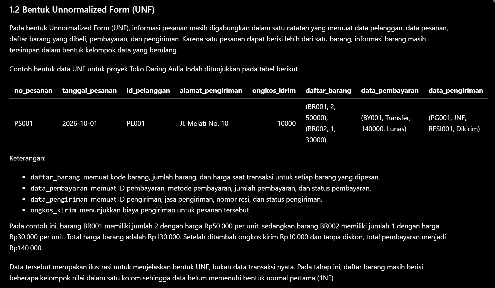

### 3.2 Bentuk Normal Pertama (1NF)

Pada tahap ini, struktur data UNF diubah menjadi bentuk normal pertama atau *First Normal Form* (1NF). Proses dilakukan dengan menghilangkan kelompok data barang yang berulang, sehingga setiap baris mewakili satu barang dalam suatu transaksi penjualan.

Setiap atribut pada tabel 1NF harus berisi nilai tunggal atau atomik. Karena satu nomor nota dapat memuat beberapa barang, nomor nota dapat muncul pada beberapa baris yang berbeda. Kunci gabungan antara nomor nota penjualan dan kode barang digunakan untuk membedakan rincian barang dalam transaksi, dengan asumsi setiap barang hanya dicatat satu kali dalam satu nota pada struktur tersebut.

Perubahan ini membuat data lebih terstruktur dan menjadi dasar untuk menganalisis dependensi fungsional serta melanjutkan proses normalisasi ke bentuk berikutnya.

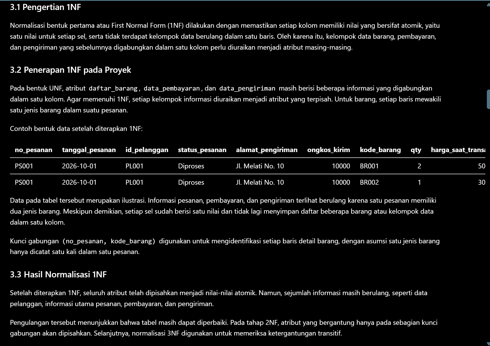

### 3.3 Penentuan Dependensi Fungsional (FD)

Setelah memperoleh struktur 1NF, langkah selanjutnya adalah menentukan dependensi fungsional atau *Functional Dependency* (FD). Dependensi fungsional menjelaskan hubungan antara atribut penentu dan atribut yang nilainya ditentukan. Penentuan ini dilakukan berdasarkan aturan bisnis yang berlaku pada data penjualan.

Pada struktur data penjualan, nomor nota menentukan informasi transaksi, seperti tanggal penjualan, kode petugas, dan nomor anggota. Kode petugas menentukan nama petugas, sedangkan nomor anggota menentukan nama anggota. Sementara itu, kode barang menentukan nama barang. Adapun jumlah barang dan harga satuan pada rincian penjualan ditentukan oleh kombinasi nomor nota dan kode barang.

Dependensi fungsional penting untuk mengidentifikasi atribut yang bergantung pada seluruh kunci gabungan maupun hanya pada sebagian kunci. Hasil analisis ini menjadi dasar untuk menentukan pemisahan tabel pada tahap 2NF dan 3NF.

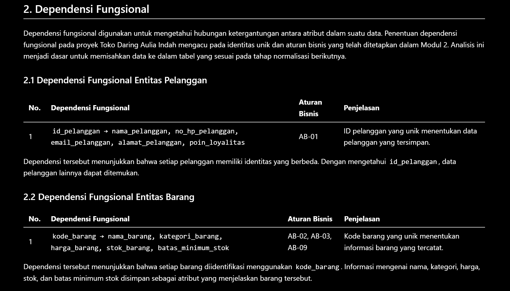
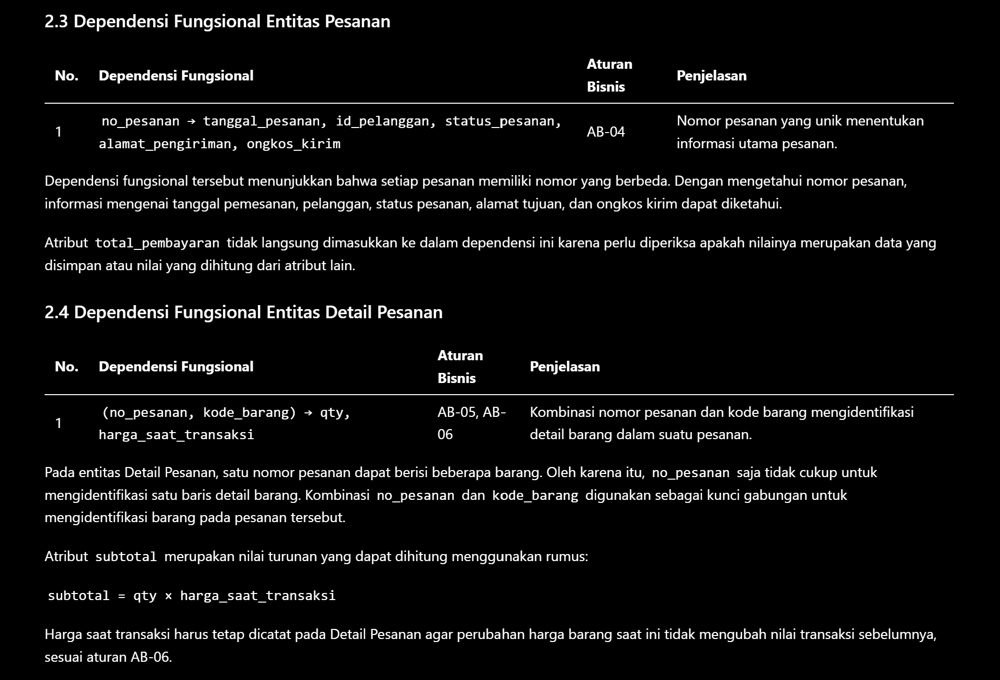
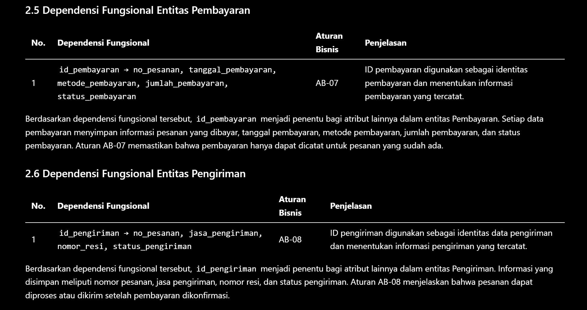

### 3.4 Bentuk Normal Kedua (2NF)

Normalisasi ke bentuk normal kedua atau *Second Normal Form* (2NF) dilakukan setelah dependensi fungsional diketahui. Suatu tabel dapat memenuhi 2NF apabila sudah memenuhi 1NF dan setiap atribut non-kunci bergantung secara penuh pada seluruh kunci kandidat, bukan hanya pada sebagian kunci gabungan.

Pada data penjualan, kunci gabungan pada tabel rincian penjualan terdiri dari nomor nota penjualan dan kode barang. Informasi seperti tanggal penjualan, kode petugas, dan nomor anggota hanya bergantung pada nomor nota, sedangkan nama barang bergantung pada kode barang. Ketergantungan sebagian tersebut perlu dipisahkan dari tabel rincian penjualan.

Hasil pemisahan menghasilkan tabel yang mewakili informasi penjualan, rincian penjualan, dan barang. Dengan struktur tersebut, informasi transaksi dan informasi barang tidak perlu diulang secara berlebihan pada setiap rincian. Tahap ini juga membantu mengurangi risiko anomali ketika data ditambahkan, diperbarui, atau dihapus.

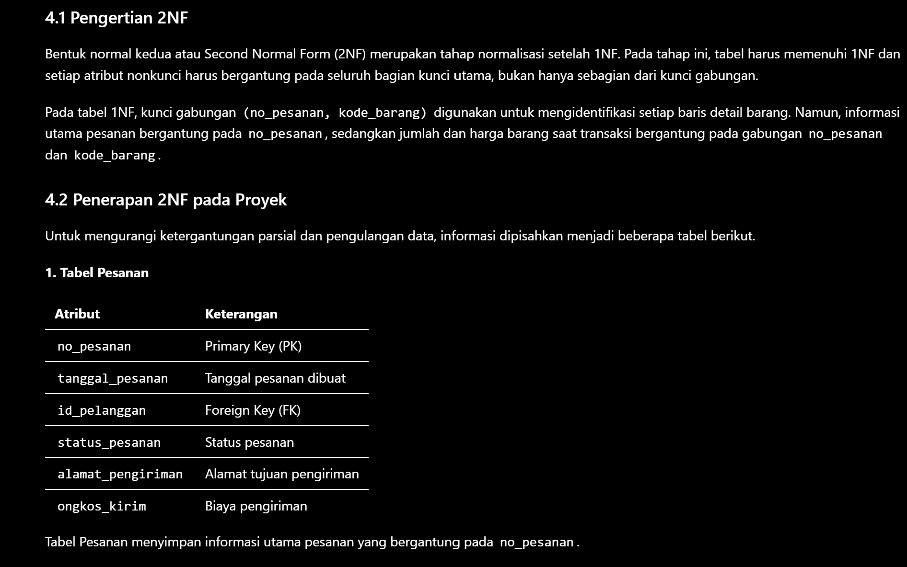
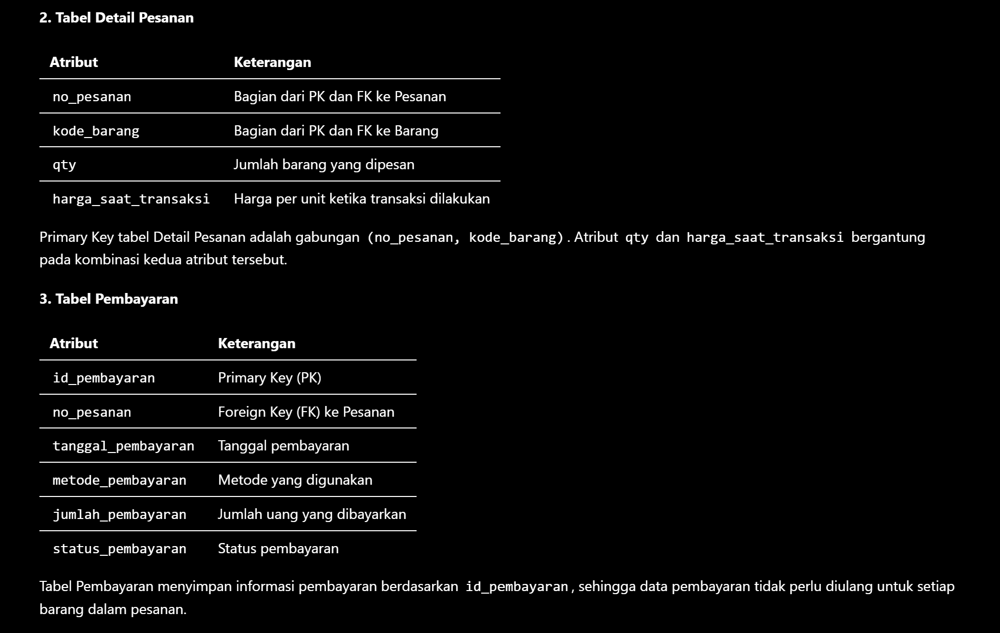
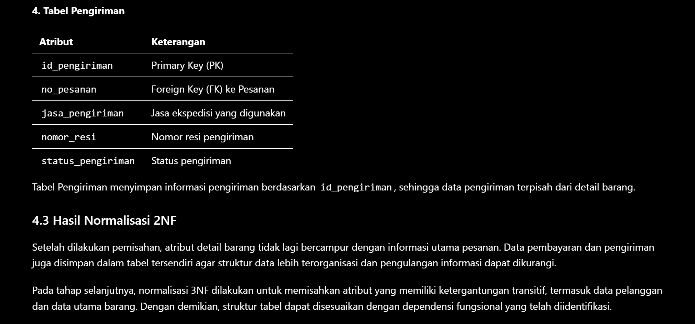

### 3.5 Bentuk Normal Ketiga (3NF)

Tahap berikutnya adalah normalisasi ke bentuk normal ketiga atau *Third Normal Form* (3NF). Pada tahap ini, pemeriksaan difokuskan pada ketergantungan transitif, yaitu keadaan ketika atribut non-kunci bergantung pada atribut non-kunci lainnya, bukan secara langsung pada kunci tabel.

Contohnya, kode petugas menentukan nama petugas, sedangkan nomor anggota menentukan nama anggota. Jika informasi tersebut tetap disimpan bersama dalam tabel transaksi, nama petugas dan nama anggota dapat berulang pada banyak transaksi. Oleh karena itu, informasi petugas dan anggota dipisahkan ke tabel masing-masing, sementara tabel penjualan menyimpan atribut yang berkaitan langsung dengan transaksi.

Pemisahan ini membuat setiap tabel memiliki fungsi yang lebih jelas. Data petugas dan anggota dapat dikelola secara terpisah, sedangkan informasi transaksi tetap terhubung melalui atribut yang sesuai. Struktur tersebut membantu mengurangi duplikasi data dan menjaga konsistensi informasi.

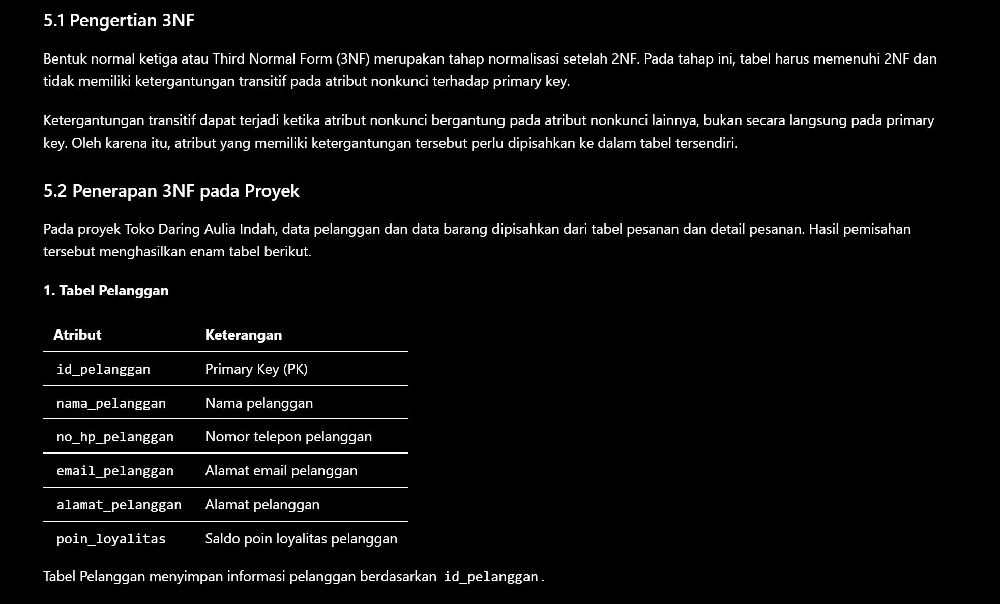
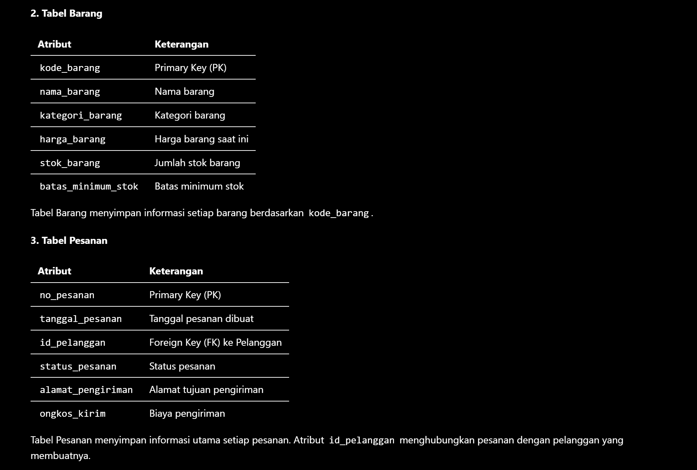
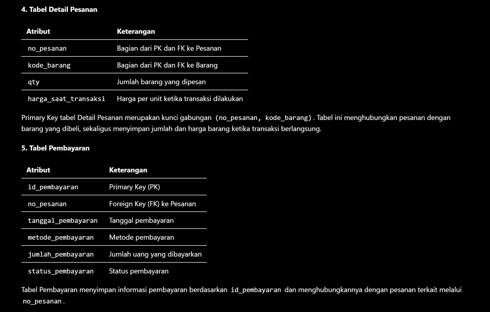
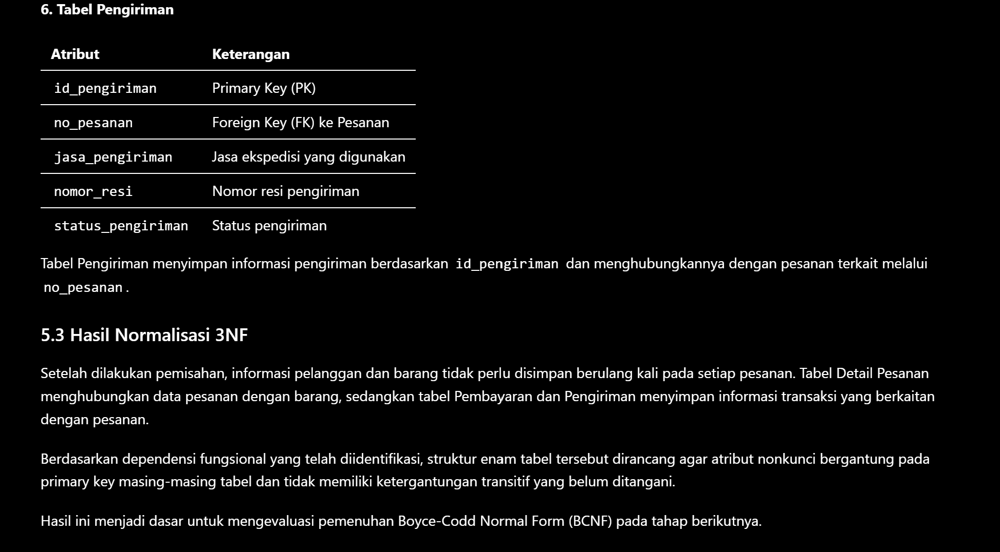

### 3.6 Identifikasi Atribut Turunan

Selain melakukan normalisasi tabel, atribut yang nilainya dapat dihitung dari atribut lain juga perlu diidentifikasi. Atribut seperti subtotal rincian penjualan, jumlah penjualan, dan total penjualan

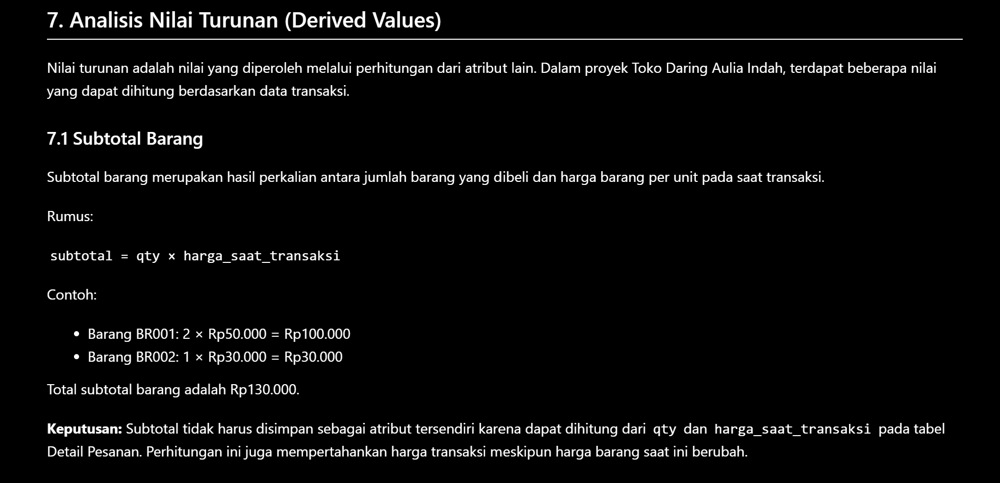
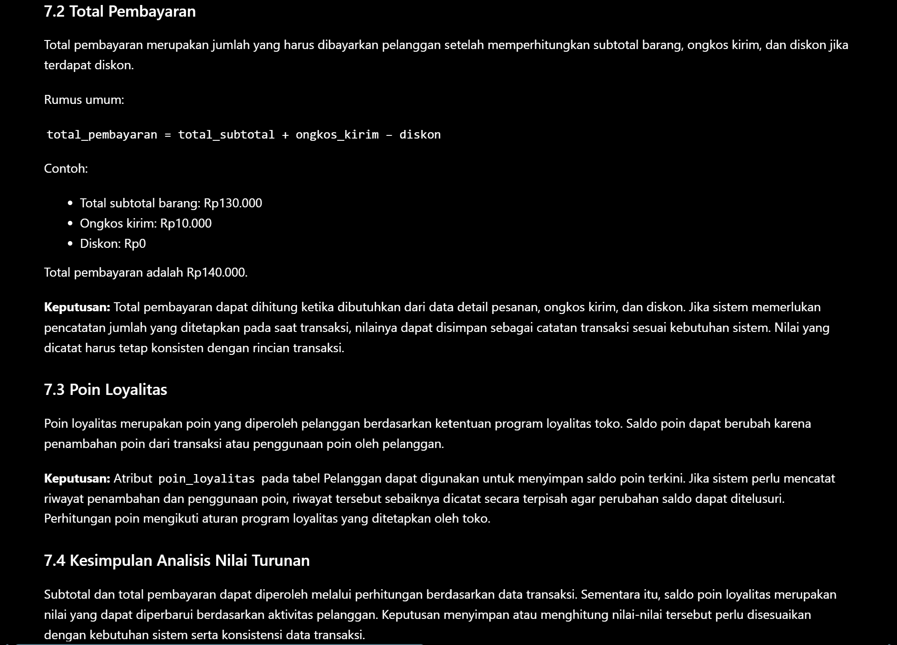

## 4. Jawaban Titik Analisis

**Jawaban Titik Analisis 1**
Harga satuan pada rincian penjualan ditentukan dari nomor nota dan kode barang. Harga yang tertera adalah harga saat transaksi. Harga barang bisa berubah. Jadi harga sekarang tidak selalu sama dengan harga saat transaksi sebelumnya. Dengan menyimpan harga saat transaksi di rincian penjualan, catatan transaksi lama tetap akurat

**Jawaban Titik Analisis 2**
Jumlah penjualan bisa dihitung dari rincian transaksi. Jadi tidak perlu disimpan lagi di tabel operasional. Ini menghindari ketidakkonsistenan. Tetapi, total penjualan bisa tetap dicatat di tabel arsip historis bila diperlukan, supaya tetap mencerminkan kondisi saat transaksi.

**Jawaban Titik Analisis 3**
Data pemasok dipisahkan dari tabel BARANG karena satu barang bisa dibeli dari pemasok berbeda. Hubungan pemasok dan pembelian dicatat di tabel PEMBELIAN, sementara barang yang dibeli dicatat di DETAIL_PEMBELIAN. Memisahkan ini mengurangi duplikasi data pemasok dan memudahkan pencatatan riwayat pembelian.

## 5. Hasil Latihan dan Modifikasi

### 5.1 Latihan 1 — Normalisasi Nomor Telepon Pemasok

Di latihan pertama, Kopma membutuhkan cara menyimpan data pemasok yang lebih fleksibel. Masalahnya adalah jika semua nomor telepon disimpan dalam satu kolom atau menggunakan banyak kolom yang sama, maka struktur tabel menjadi kaku. Setiap kali ada nomor telepon baru atau nomor telepon dihapus, kita harus mengubah struktur tabel. Ini tidak praktis.

Untuk mengatasi masalah ini, data pemasok dan nomor telepon dipisah menjadi dua tabel yang saling terhubung.

**Tabel PEMASOK**

- `id_pemasok` (primary key)

- `nama_pemasok`

**Tabel TELEPON_PEMASOK**

- `id_pemasok` (primary key, foreign key)

- `no_telepon` (primary key)

Di tabel TELEPON_PEMASOK, kombinasi `id_pemasok` dan `no_telepon` menjadi primary key gabungan. Artinya, setiap kombinasi dari id pemasok dan nomor telepon harus unik. Kolom `id_pemasok` juga berfungsi sebagai foreign key yang menghubungkan tabel ini ke tabel PEMASOK.

Dengan cara ini, satu pemasok bisa punya satu atau lebih nomor telepon. Tidak perlu menambahkan kolom baru untuk tiap nomor telepon. Jika ada nomor telepon baru, kita tinggal tambahkan baris baru di tabel TELEPON_PEMASOK. Jika ada nomor telepon yang dihapus, kita hapus barisnya saja. Struktur ini sangat fleksibel dan lebih mudah dikelola.

### 5.2 Latihan 2 — Contoh Pelanggaran 3NF dan Anomali Pembaruan

Ada masalah dalam tabel PENJUALAN yang menyimpan `nama_anggota` langsung di dalamnya. Masalahnya adalah satu anggota bisa melakukan banyak transaksi. Maka nama anggota yang sama akan muncul berulang kali di tabel. Ini menyebabkan pengulangan data.

Contoh data:

| id_penjualan | no_nota_penjualan | id_anggota | nama_anggota |
|---|---|---|---|
| 1 | NT001 | A001 | Rina |
| 2 | NT002 | A001 | Rina |
| 3 | NT003 | A002 | Dimas |

Jika nama anggota Rina berubah menjadi Rina Putri, kita harus memperbarui semua baris yang mencantumkan nama Rina. Tapi kalau hanya memperbarui satu baris saja, misalnya dengan nomor nota NT001, maka hasilnya tidak konsisten.

Contoh perintah SQL:

```sql
UPDATE PENJUALAN
SET nama_anggota = 'Rina Putri'
WHERE no_nota_penjualan = 'NT001';
```

Setelah perintah ini dijalankan, nomor nota NT001 akan menampilkan nama Rina Putri. Tapi nomor nota NT002 masih menampilkan nama Rina. Ini berarti satu anggota memiliki dua nama yang berbeda di satu tabel. Kondisi seperti ini disebut anomali pembaruan. Data menjadi tidak konsisten karena satu informasi yang sama disimpan di banyak tempat.

Untuk menghindari masalah ini, sebaiknya informasi anggota seperti `nama_anggota` disimpan di tabel terpisah, misalnya tabel ANGGOTA. Tabel PENJUALAN hanya menyimpan `id_anggota` sebagai foreign key yang menghubungkan ke tabel ANGGOTA.

Dengan memisahkan data anggota dan data penjualan, kita bisa mengurangi pengulangan data. Saat nama anggota diubah, kita hanya perlu mengubah satu baris di tabel ANGGOTA. Semua transaksi yang terkait akan secara otomatis menampilkan nama yang terbaru. Ini menjaga konsistensi data dan membuat sistem lebih efisien.

## 6. Tugas Mandiri: Milestone Proyek 4

### 6.1 Dokumen Sumber dan Normalisasi
Proses normalisasi dilakukan dengan menggunakan dokumen kebutuhan data dari proyek Toko Daring Aulia Indah yang ada di Modul 2. Dokumen yang digunakan meliputi halaman pesanan, bukti pembayaran, dan resi pengiriman.

Penjelasan singkat tentang perubahan data dari bentuk UNF ke 1NF, 2NF, dan 3NF berdasarkan analisis yang ada di file `p04_normalisasi_25430073.md`.

### 6.2 Dependensi Fungsional
Dependensi fungsional ditentukan sesuai dengan aturan bisnis yang sudah dibuat pada Modul 2. Kode aturan yang digunakan mencakup AB-01 sampai AB-09. Aturan ini terkait dengan atribut dan entitas yang ada dalam data.

### 6.3 Hasil Pemeriksaan BCNF
Hasil pemeriksaan BCNF dilakukan untuk enam tabel proyek, yaitu Pelanggan, Barang, Pesanan, Detail Pesanan, Pembayaran, dan Pengiriman. Kesimpulan didasarkan pada dependensi fungsional yang sudah diidentifikasi sebelumnya.

### 6.4 Keputusan Penyimpanan Nilai Turunan
Keputusan diambil mengenai atribut `subtotal`, `total_pembayaran`, dan `poin_loyalitas`. Setiap nilai dicari tahu apakah dihitung saat dibutuhkan atau disimpan untuk keperluan transaksi. Alasan diberikan sesuai dengan analisis yang ada di file normalisasi.

### 6.5 Evaluasi ERD
ERD proyek diperiksa apakah mengalami perubahan setelah proses normalisasi. Jika ada perubahan, bagian yang berubah disebutkan. Jika tidak ada perubahan besar, maka dinyatakan bahwa ERD diperiksa agar entitas, atribut, kunci, dan hubungan antartabel sesuai hasil normalisasi.

## 7. Pembahasan dan Kendala

### 7.1 Pembahasan

Dari praktikum yang telah dilakukan, proses normalisasi membantu mengatur data proyek Toko Daring Aulia Indah agar lebih rapi dan mengurangi pengulangan data. Normalisasi dilakukan dengan memeriksa dokumen sumber, mengidentifikasi dependensi fungsional sesuai aturan bisnis, serta membagi atribut ke dalam tabel yang lebih sesuai.

Pada tahap 1NF, data barang yang sebelumnya disimpan bersama dalam satu pesanan dipisah agar setiap nilai atribut bisa dicatat secara terpisah. Kemudian di tahap 2NF, atribut yang hanya bergantung pada sebagian dari kunci gabungan dipisahkan dari tabel Detail Pesanan. Di tahap 3NF, informasi pelanggan dipisahkan dari tabel Pesanan agar tidak terjadi pengulangan data pelanggan di setiap transaksi.

Pemeriksaan BCNF dilakukan untuk memastikan bahwa setiap penentu dalam dependensi fungsional adalah kunci yang sah. Selain itu, atribut turunan seperti `subtotal` dan `total_pembayaran` diperiksa untuk menentukan apakah nilai-nilai tersebut sebaiknya dihitung saat dibutuhkan atau disimpan agar catatan transaksi tetap akurat. Hasil dari normalisasi ini bisa digunakan sebagai dasar dalam menyusun struktur tabel dan hubungan antar tabel pada tahap selanjutnya dari praktikum.

### 7.2 Kendala

Salah satu kendala utama dalam praktikum ini adalah menentukan dependensi fungsional dan membedakan antara atribut yang bergantung pada kunci utama dengan atribut yang bergantung pada atribut lain. Selain itu, dibutuhkan ketelitian dalam menentukan kunci utama gabungan pada tabel Detail Pesanan serta memutuskan cara menangani nilai turunan seperti `subtotal` dan `total_pembayaran`.

Kendala ini diatasi dengan memeriksa kembali aturan bisnis pada Modul 2, mengidentifikasi hubungan antar atribut, serta mengevaluasi struktur tabel di setiap tahap normalisasi. Dengan cara ini, rancangan basis data menjadi lebih jelas dan bisa digunakan sebagai acuan untuk tahap implementasi selanjutnya.

## 8. Kesimpulan

Setelah mengikuti praktikum Modul 4, saya menyadari bahwa normalisasi adalah langkah penting saat membuat basis data. Normalisasi membantu data menjadi lebih teratur dan menghilangkan duplikasi yang tidak perlu. Untuk melakukan normalisasi, saya pertama‑tama memeriksa dokumen sumber, lalu menentukan dependensi fungsional, dan akhirnya membuat tabel sesuai dengan tahapan 1NF, 2NF, dan 3NF. Saya juga memeriksa BCNF agar semua ketergantungan antaratribut sesuai dengan kunci.

Pada proyek Toko Daring Aulia Indah, saya memisahkan data ke dalam tabel‑tabel yang berbeda: Pelanggan, Barang, Pesanan, Detail Pesanan, Pembayaran, dan Pengiriman. Setiap tabel memiliki fungsi yang jelas. Saya juga memeriksa atribut turunan seperti `subtotal` dan `total_pembayaran`. Saya memutuskan apakah nilai itu harus dihitung setiap kali dibutuhkan atau disimpan dalam catatan transaksi. Praktikum ini memberi saya dasar untuk membuat struktur tabel dan hubungan database yang lebih rapi di tahap implementasi berikutnya.

## 9. Pernyataan Penggunaan AI

Saat menulis laporan praktikum ini, saya memakai AI sebagai bantuan untuk memahami konsep normalisasi basis data, memeriksa dependensi fungsional, dan memperbaiki penjelasan supaya lebih jelas. Saya menggunakan hasil bantuan AI sebagai bahan belajar dan referensi saat menyelesaikan tugas. Saya tetap bertanggung jawab untuk memeriksa ulang laporan dan menyesuaikannya dengan tugas serta aturan di buku praktikum.

## 10. Bukti Git (tautan repositori + hash commit)

**Tautan repositori GitHub:** (https://github.com/auliaindahagustina/basisdata-25430073)
**Hash commit Modul 3:** `781989c`
Pesan commit: p04: normalisasi basis data

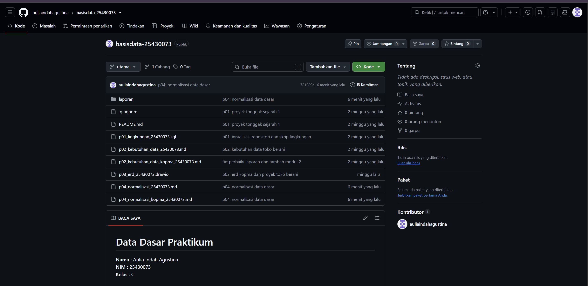

## Checklist 

| No. | Checklist Umum | Status |
|---|---|:---:|
| 1 | Identitas: nama, NIM, kelas, nomor pertemuan, tanggal, serta nama dosen/asisten | ☑️ |
| 2 | Tujuan praktikum ditulis dengan bahasa sendiri dan maksimal 5 baris | ☑️ |
| 3 | Ringkasan dasar teori ditulis berdasarkan pemahaman sendiri dan maksimal setengah halaman | ☑️ |
| 4 | Hasil langkah percobaan dilengkapi tangkapan layar dan keterangan | ☑️ |
| 5 | Semua Titik Analisis (TA) dijawab dan disertai alasan | ☑️ |
| 6 | Hasil latihan dan modifikasi dicantumkan beserta bukti | ☑️ |
| 7 | Tugas Mandiri/Milestone Proyek dikerjakan dan dilengkapi bukti | ☑️ |
| 8 | Pembahasan dan kendala selama praktikum dijelaskan beserta solusinya | ☑️ |
| 9 | Kesimpulan berisi hasil yang diperoleh dari praktikum | ☑️ |
| 10 | Pernyataan penggunaan AI dicantumkan secara jujur | ☑️ |
| 11 | Bukti Git berupa tautan repositori dan hash commit dicantumkan | ☑️ |
| 12 | Bukti keaslian pengerjaan/screenshot menunjukkan informasi yang diperlukan sesuai ketentuan | ☑️ |


## Turnitin