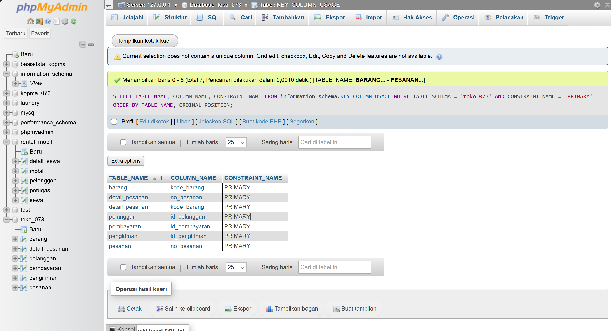
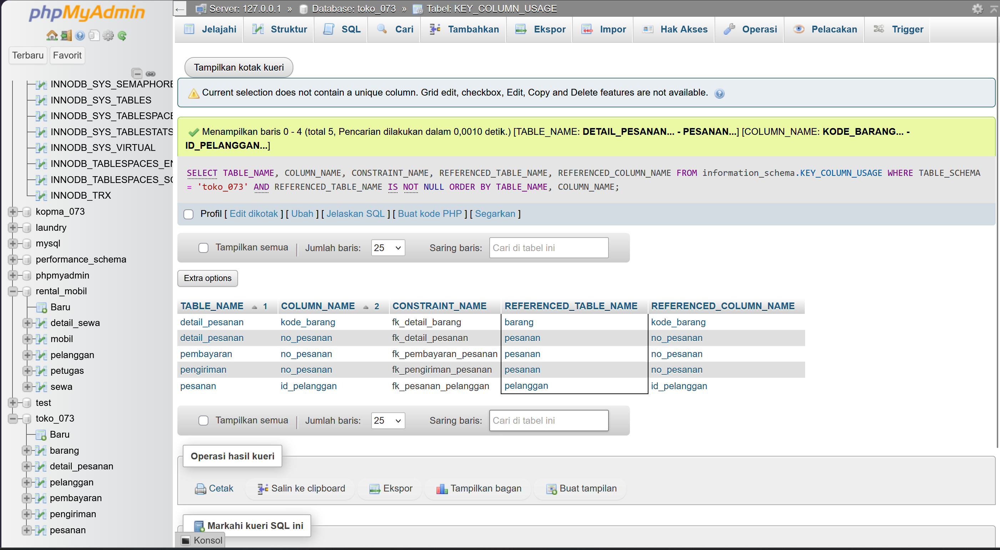
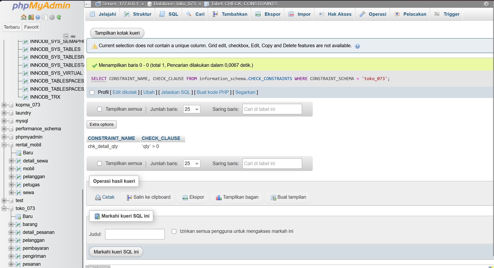
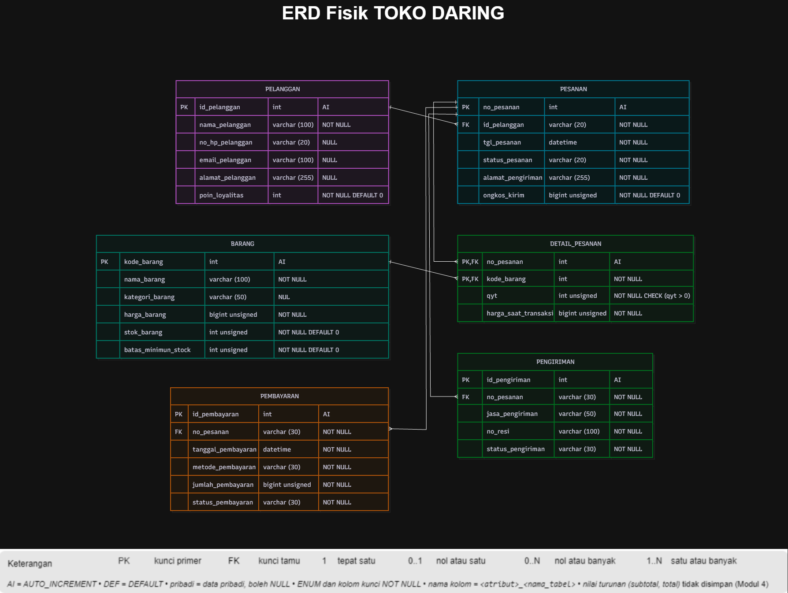

# Laporan Praktikum Basis Data - Pertemuan ke 5

**Nama:** Aulia Indah Agustina
**NIM:**25430073
**Kelas:** C
**Tanggal:** 27/10/2025
**Dosen:** Dedi Irawan, S.Kom., M.T.I.

## 1. Tujuan Praktikum

Praktikum ini bertujuan untuk memahami dan mengaplikasikan perintah DDL (*Data Definition Language*) dalam pembuatan serta pengelolaan struktur tabel di basis data. Di samping itu, praktikum ini bertujuan untuk menerapkan *constraint* seperti *Primary Key*, *Foreign Key*, *NOT NULL*, *DEFAULT*, dan *CHECK* sehingga data yang disimpan sesuai dengan ketentuan yang telah ditetapkan.

## 2. Ringkasan Dasar Teori

DDL (*Data Definition Language*) merupakan komponen SQL yang digunakan untuk mendirikan dan mengelola struktur tabel dalam basis data. Beberapa perintah yang digunakan adalah `CREATE TABLE` untuk menciptakan tabel, `ALTER TABLE` untuk mengubah struktur tabel, dan `DROP TABLE` untuk menghapus tabel.
Dalam membuat tabel, terdapat ketentuan yang disebut *constraint* untuk mengatur data yang boleh dimasukkan. *Primary Key* berfungsi sebagai identifikasi yang unik pada setiap data, sementara *Foreign Key* digunakan untuk menghubungkan satu tabel dengan tabel lainnya. Di samping itu, `NOT NULL` berfungsi untuk mencegah kolom dari nilai kosong, `DEFAULT` berperan dalam memberikan nilai awal secara otomatis, dan `CHECK` digunakan untuk memastikan bahwa nilai yang dimasukkan memenuhi kondisi yang telah ditentukan.
Dengan menggunakan DDL dan *constraint*, struktur tabel dapat disusun sesuai keperluan dan data dalam database menjadi lebih teratur. Pengujian juga perlu dilakukan untuk memastikan bahwa aturan yang telah ditetapkan berfungsi dengan baik.

## 3. Hasil Langkah Percobaan (tangkapan layar + keterangan)

### D.1 Merancang Tabel Utama
Pada tahap ini, saya membentuk struktur tabel untuk menyimpan data utama di dalam database `toko_073`. Tabel yang dibuat mencakup `pelanggan` dan `barang`. Setiap tabel memiliki kolom dengan jenis data yang sesuai dengan informasi yang disimpan, seperti kode, nama, harga, dan jumlah stok. Saya juga menetapkan primary key supaya setiap data memiliki identitas yang pasti.

**Gambar 1.** Hasil tabel yang dibuat dalam database `toko_073`

### D.2 Membentuk Tabel dengan Foreign Key
Setelah menyusun tabel utama, saya membuat tabel-tabel yang terhubung dengan tabel lainnya, yaitu `pesanan`, `detail_pesanan`, `pembayaran`, dan `pengiriman`. Pada fase ini, saya memanfaatkan foreign key untuk mengaitkan tabel sesuai dengan hubungan yang telah direncanakan. Dengan cara ini, data dalam tabel yang terhubung bisa tetap konsisten.

**Gambar 2.** Hasil implementasi primary key di tabel

**Gambar 3.** Hasil implementasi foreign key pada tabel

### D.3 Menunjukkan Penerapan Constraint
Pada langkah ini, saya menilai apakah constraint yang telah ditetapkan dapat mempertahankan data sesuai dengan ketentuan. Sebuah pengujian dilaksanakan pada kolom `qty` dalam tabel `detail_pesanan`. Saat nilai `qty` dimasukkan dengan angka 0, MariaDB menolak instruksi tersebut karena melanggar constraint `chk_detail_qty`, yang mengharuskan jumlah barang lebih dari 0.

**Gambar 4.** Hasil implementasi constraint pada tabel

### D.4 Mengubah Struktur dan Melakukan Perbandingan dengan ERD
Pada tahap ini, struktur tabel ditinjau ulang untuk memastikan kesesuaiannya dengan desain database. Saya turut memeriksa keterkaitan antartabel melalui susunan tabel dan relasi yang ada di phpMyAdmin. Pemeriksaan ini membantu memastikan bahwa tabel, primary key, foreign key, dan constraint yang dibuat telah sesuai dengan keperluan proyek Toko Daring Aulia Indah.

**Gambar 5.** Hasil perubahan struktur tabel `barang` dengan penambahan kolom `tgl_kedaluwarsa` bertipe data `DATE`

**Gambar 6.** Tampilan Designer pada phpMyAdmin yang menunjukkan struktur dan hubungan antartabel pada database `toko_073`

## 4. Jawaban Titik Analisis

**Jawaban Titik Analisis 1**
Kunci asing `fk_detail_penjualan` menerapkan `ON DELETE CASCADE` karena rincian penjualan tergantung pada data penjualan. Jika sebuah penjualan dihapus, informasi mengenai barang yang terdapat di dalamnya juga akan hilang. Sementara itu, `fk_detail_barang` tidak menerapkan `ON DELETE CASCADE` karena data barang dapat dimanfaatkan dalam berbagai transaksi. Apabila barang dihapus beserta semua rincian penjualan sebelumnya, catatan transaksi dan laporan penjualan dapat kehilangan data mengenai barang yang pernah dibeli. Oleh sebab itu, informasi mengenai barang yang telah digunakan dalam transaksi sebaiknya tidak dihapus secara langsung.

**Jawaban Titik Analisis 2**
Kode kesalahan 1452 menunjukkan bahwa kunci asing menolak data yang mengacu pada entitas induk yang tidak ada. Kode ini menjamin bahwa setiap transaksi harus diwakili oleh petugas yang terdaftar. Kode kesalahan 4025 menunjukkan bahwa data ditolak karena melanggar batasan `CHECK`, contohnya stok barang diisi dengan nilai yang negatif. Kode kesalahan 1062 menunjukkan bahwa data ditolak karena nilai yang diinput melanggar ketentuan unik, seperti kode barang yang sudah ada.
Aturan bisnis yang melibatkan banyak data atau transaksi yang lebih rumit tidak selalu dapat dipertahankan hanya dengan constraint. Misalnya, menjamin setiap pesanan memiliki minimal satu detail tidak bisa hanya dilakukan dengan `CHECK` standar karena aturan tersebut melibatkan lebih dari satu baris data.

**Jawaban Titik Analisis 3**
Perintah `DROP TABLE IF EXISTS` harus dilakukan dari tabel anak, seperti `detail_pembelian` dan `detail_penjualan`, terlebih dahulu sebelum menghapus tabel induk seperti `pembelian`, `penjualan`, atau `petugas`. Ini disebabkan oleh tabel anak yang mempunyai foreign key yang mengacu ke tabel induk. Apabila tabel utama dihapus terlebih dahulu saat masih dirujuk oleh tabel sekunder, MariaDB dapat menolak penghapusan dan menunjukkan kesalahan seperti `ERROR 1451` atau kesalahan yang berkaitan dengan foreign key. Dengan menghapus tabel dari yang lebih rendah ke yang lebih tinggi, struktur database dapat dihapus dalam urutan yang tepat.

## 5. Hasil Latihan dan Modifikasi

### E.1 Menyisipkan Constraint CHECK pada Stok Minimum
Dalam latihan ini, modul meminta penambahan batasan `CHECK` untuk memastikan nilai stok minimum tetap tidak negatif. Dalam database e-commerce, kolom yang relevan adalah `batas_minimum_stok` dalam tabel `barang`. Constraint ini bertujuan untuk memastikan bahwa nilai stok minimum tidak terisi dengan bilangan negatif.
Pengujian nilai negatif harus dianalisis berdasarkan hasil yang ditunjukkan oleh MariaDB. Pada pengujian sebelumnya, nilai negatif ditolak karena tipe data `UNSIGNED`, tetapi hasil tersebut belum menunjukkan bahwa constraint `CHECK` untuk stok minimum telah berfungsi. Oleh sebab itu, pengujian ini harus dibedakan dari pengujian constraint `CHECK` pada kolom `qty` yang telah berhasil menolak nilai 0.

### E.2 Perubahan Aturan Foreign Key menjadi ON DELETE SET NULL
Dalam latihan ini, modul meminta penyesuaian foreign key sehingga saat data anggota dihapus, kolom anggota pada tabel penjualan menjadi `NULL`. Tujuannya adalah agar data transaksi yang lama tetap terarsip meskipun data anggota telah dihapus.
Dalam proyek toko online, modifikasi yang serupa hanya bisa dilakukan jika relasi tabel dan aturan bisnisnya benar-benar selaras. Apabila data pelanggan dihapus, relasi pada tabel `pesanan` dapat disetel menjadi `NULL` jika kolom foreign key memperbolehkan nilai `NULL` dan kebijakan bisnis mengizinkannya. Akan tetapi, perubahan ini belum dapat dianggap berhasil sampai struktur foreign key diubah dan dilakukan pengujian.

## 6. Tugas Mandiri: Milestone Proyek 5

### 6.1 Penyusunan Struktur Basis Data
Pada pencapaian ini, saya menyusun struktur basis data untuk proyek Toko Daring Aulia Indah dengan menggunakan MariaDB melalui phpMyAdmin. Database yang dipakai bernama `toko_073`, terdiri dari enam tabel, yaitu `pelanggan`, `barang`, `pesanan`, `detail_pesanan`, `pembayaran`, dan `pengiriman`. Tiap tabel dihasilkan berdasarkan kebutuhan data dalam platform toko online.

### 6.2 Implementasi Primary Key, Foreign Key, Constraint
Setiap tabel dilengkapi dengan primary key sebagai identitas data. Kunci asing digunakan untuk mengaitkan tabel yang saling berhubungan. Saya pun menggunakan constraint, seperti `NOT NULL`, `DEFAULT`, dan `CHECK`, sesuai dengan kebutuhan setiap kolom. Salah satu pengujian yang berhasil dilakukan adalah mengisi nilai `qty` sebesar 0 di tabel `detail_pesanan`. MariaDB menolak data itu karena melanggar constraint `chk_detail_qty`, yang menetapkan bahwa jumlah barang harus lebih dari 0.

### 6.3 File SQL Proyek
Perintah SQL yang digunakan untuk membangun struktur database tersimpan dalam file `p05_ddl_25430073.sql`. Dokumen ini berisi instruksi untuk membuat tabel, menentukan tipe data, kunci utama, kunci asing, serta batasan yang diperlukan. Skrip juga harus memiliki perintah untuk menghapus tabel dengan urutan yang tepat agar dapat dijalankan lagi dari basis data yang kosong.

### 6.4 Dokumentasi dan ERD Fisik
ERD fisik berfungsi untuk menggambarkan struktur tabel, atribut, tipe data, primary key, foreign key, serta constraint yang ada dalam database. ERD itu harus dibandingkan dengan struktur tabel yang ada di phpMyAdmin untuk memastikan apakah desain dan pelaksanaannya sudah sesuai.

### 6.5 Hasil Tonggak
Dengan milestone ini, saya memahami cara mendirikan struktur database memakai DDL dan menerapkan constraint untuk memastikan kesesuaian data. Struktur basis data dan beberapa batasan telah disusun serta diuji. Dokumentasi ERD fisik, verifikasi kecocokan semua tabel, dan pengujian ulang skrip harus dipastikan lengkap sebelum milestone dinyatakan selesai.

## 7. Pembahasan dan Kendala

Dalam praktikum Modul 5, saya merancang struktur basis data Toko Daring Aulia Indah dengan MariaDB melalui phpMyAdmin. Database ini terdiri atas enam tabel, yaitu `pelanggan`, `produk`, `order`, `detail_order`, `transaksi`, dan `pengiriman`. Setiap tabel memiliki susunan kolom dan jenis data yang disesuaikan dengan kebutuhan penyimpanan informasi. Saya juga menggunakan primary key dan foreign key untuk memastikan identitas data serta hubungan antar tabel dapat diidentifikasi dengan jelas.
Selain itu, saya belajar tentang pemanfaatan constraint untuk memastikan bahwa data yang diinput sesuai dengan ketentuan. Salah satu hasil uji coba menunjukkan bahwa saat kolom `qty` dalam tabel `detail_pesanan` diisi angka 0, MariaDB menolak perintah itu karena bertentangan dengan constraint `chk_detail_qty`. Ini menunjukkan bahwa batasan dapat mencegah data yang tidak relevan masuk ke dalam database.
Masalah yang dihadapi selama proses pengerjaan adalah pentingnya memperhatikan jenis data dan relasi antar tabel saat membuat foreign key. Di samping itu, pengujian batasan harus dilakukan secara cermat untuk memastikan bahwa aturan yang ditetapkan berfungsi dengan baik. Dalam pengujian nilai negatif untuk stok minimum, belum dapat dipastikan bahwa penolakan data berasal dari constraint `CHECK` karena tipe data yang digunakan juga berdampak pada hasilnya.
Melalui kegiatan praktikum ini, saya semakin paham mengenai cara membuat struktur tabel, menghubungkan antar tabel, dan menerapkan aturan dalam database. Saya juga menyadari bahwa setiap batasan perlu diuji dan hasilnya harus dicatat agar struktur database dapat diverifikasi kembali.

## 8. Kesimpulan

Berdasarkan praktik Modul 5, saya mengerti cara membangun dan mengatur struktur basis data menggunakan perintah DDL di MariaDB. Saya mempelajari pemakaian tipe data, kunci utama, kunci asing, serta batasan seperti `NOT NULL`, `DEFAULT`, dan `CHECK` untuk memastikan bahwa data sesuai dengan aturan yang telah ditetapkan.
Di proyek Toko Daring Aulia Indah, saya menggunakan materi tersebut pada enam tabel, yaitu `pelanggan`, `produk`, `pesanan`, `detail_pesanan`, `pembayaran`, dan `pengiriman`. Hasil pengujian menunjukkan bahwa saat kolom `qty` dalam tabel `detail_pesanan` diisi dengan angka 0, MariaDB menolak perintah itu dengan kode kesalahan `4025` karena melanggar constraint `chk_detail_qty`. Ini menunjukkan bahwa kebijakan jumlah barang lebih dari 0 telah dilaksanakan pada kolom itu.
Selain itu, pengujian nilai negatif pada stok minimum menunjukkan bahwa data ditolak atau mengalami peringatan akibat batas tipe data yang digunakan. Namun, hasil itu belum menunjukkan bahwa constraint `CHECK` yang ditetapkan untuk stok minimum telah berfungsi. Dari praktikum ini, saya mengerti bahwa struktur database tidak hanya perlu dirancang, tetapi juga harus diuji agar aturan yang diterapkan bisa diperiksa dan hasilnya dapat dibuktikan.

## 9. Pernyataan Penggunaan AI

Dalam pengerjaan laporan praktikum Modul 5, saya menggunakan bantuan AI untuk memahami materi, memeriksa penulisan, dan membantu menyusun penjelasan mengenai struktur tabel, *primary key*, *foreign key*, serta *constraint* pada database. AI juga digunakan sebagai pendamping untuk memahami hasil pengujian database dan menyusun pembahasan dengan bahasa yang lebih mudah dipahami.

Seluruh hasil pengerjaan tetap saya periksa dan sesuaikan dengan praktik yang telah dilakukan pada database `toko_073`. Saya bertanggung jawab atas isi laporan dan memastikan bahwa hasil yang dituliskan sesuai dengan hasil pengerjaan serta pengujian yang sebenarnya.

## 10. Bukti Git (tautan repositori + hash commit)

**Tautan repositori GitHub:** (https://github.com/auliaindahagustina/basisdata-25430073)
**Hash commit Modul 3:** `781989c`
Pesan commit: p04: normalisasi basis data

## Checklist 

| No. | Checklist Umum | Status |
|---|---|:---:|
| 1 | Identitas: nama, NIM, kelas, nomor pertemuan, tanggal, serta nama dosen/asisten | ☑️ |
| 2 | Tujuan praktikum ditulis dengan bahasa sendiri dan maksimal 5 baris | ☑️ |
| 3 | Ringkasan dasar teori ditulis berdasarkan pemahaman sendiri dan maksimal setengah halaman | ☑️ |
| 4 | Hasil langkah percobaan dilengkapi tangkapan layar dan keterangan | ☑️ |
| 5 | Semua Titik Analisis (TA) dijawab dan disertai alasan | ☑️ |
| 6 | Hasil latihan dan modifikasi dicantumkan beserta bukti | ☑️ |
| 7 | Tugas Mandiri/Milestone Proyek dikerjakan dan dilengkapi bukti | ☑️ |
| 8 | Pembahasan dan kendala selama praktikum dijelaskan beserta solusinya | ☑️ |
| 9 | Kesimpulan berisi hasil yang diperoleh dari praktikum | ☑️ |
| 10 | Pernyataan penggunaan AI dicantumkan secara jujur | ☑️ |
| 11 | Bukti Git berupa tautan repositori dan hash commit dicantumkan | ☑️ |
| 12 | Bukti keaslian pengerjaan/screenshot menunjukkan informasi yang diperlukan sesuai ketentuan | ☑️ |

## Turnitin